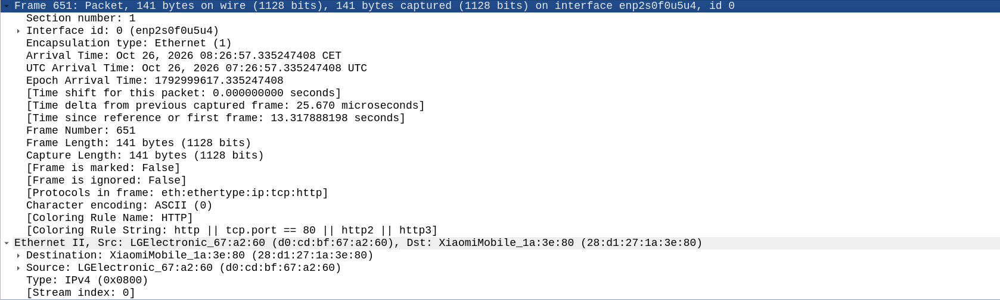
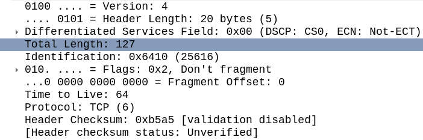
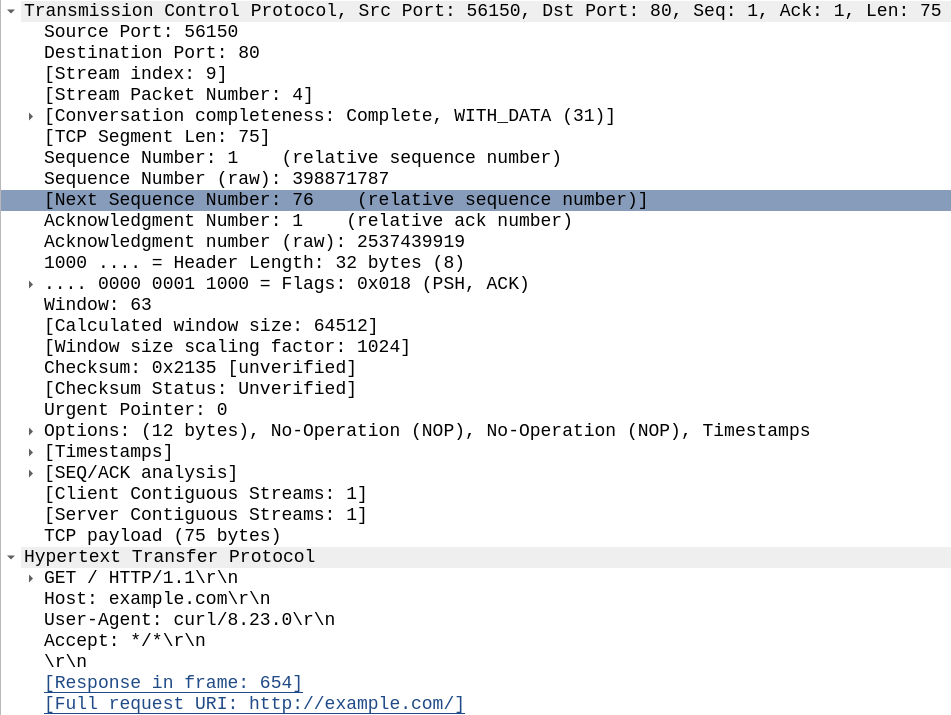
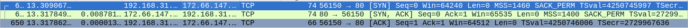

# Week 1

Done when: captured a TCP handshake, DNS lookup and ARP exchange, annotated.

## What I did
### OSI Model & TCP / IP model  

| OSI | TCP/IP |
|---|---|
| 7 Application | 4 Application |
| 6 Presentation | 4 Application |
| 5 Session | 4 Application |
| 4 Transport | 3 Transport |
| 3 Network | 2 Internet |
| 2 Data Link | 1 Link |
| 1 Physical | 1 Link |

Conceptual model made by ISO to standardazie the different functions in a network.  
Layer Summary:  
7 - closest to the end user. HTTP / HTTPS. Interacts with Software Apps. Identifies communication partners and synchronizes communication.  
6 - Translates between application and network formats. Encryption / decryption of data. Translated between Application - Layer formats.  
5 - controls sessions between hosts. Manages connections btw local app and remote app (browser - YouTube).  

7, 6, 5 - mostly app devs work with them.  

4 - breaks large pieces of data into smaller segments for easier sending. Process-to-process communication.  
3 - connectivity btw end hosts on different networks  (outside LAN). IP addresses. Path selection. Routers are here.
2 - node-to-node connectivity and data transfer (ex. PC to Switch). Formatting for transmission over a physical medium. Detects and corrects layer 1 errors. Separate addressing from Layer 3. Switches are here.  
1 - physical characteristics: voltages, distances, physical connectors, cables. Digital bits converted into electrical or radio signals.

TCP/IP:
Actually used in modern networks. OSI is still important.  
4 - Layers 7, 6, 5 OSI = TCP/IP Layer 4.  
4 OSI = 3 TCP IP.  
3 OSI = 2 Internet TCP IP.  
2 + 1 OSI = 1 TCP IP.

  
Encapsulation:  
### Encapsulation

1. **Application (7, 6, 5):** data is prepared
2. **Transport (4):** add L4 header → **Segment**
3. **Network (3):** add L3 header → **Packet**
4. **Data Link (2):** add L2 header and L2 trailer → **Frame**
5. **Physical (1):** the frame is sent over the cable as **Bits**

Final frame layout: `L2 header | L3 header | L4 header | Data | L2 trailer`

De-encapsulation:
Same is encapsulation but reversed order - remove tailer and header as we go up the model.  
Get Data at the end - 7, 6, 5.

### First Packet Inspection - curl http://example.com
  
Ethernet Source and Destination MACs can be seen under Ethernet II
  
IP source and destination not shown here, protocol = TCP (6)
  
TCP: Source Port 56150, destination 80, FDASS flags, seq num = 1  
HTTP: GET HTTP 1.1

## TCP & UDP
* A port is used to direct traffic to a specific application process. Socket is the combination of an IP address and a port number (192.168.1.10:80)
* TCP creates a reliable logical connection before sending data. It does this thru a 3-way handshake:
1. SYN: The client requests a connection
2. SYN-ACK: The server acknowledges the request and sends its own connection request.
3. ACK: The client acknowledges the server, and the connection is established.
* Sequence Numbers and ACKs: TCP assigns sequential numbers to packets to ensure they are processed in the right order. When the receiver gets the data, it sends back an Acknowledgment (ACK) to confirm receipt.
* UDP Difference: UDP is a connectionless protocol that provides "best-effort" delivery. It doesn't use handshakes or guarantee delivery. Much faster but unreliable compared to TCP.

### TCP Handshake

Different flags (RST, FIN, DATA, ACK, SYN-ACK, SYN) are present.  
Most importantly: ACK, SYN-ACK, SYN.

## What broke
...
